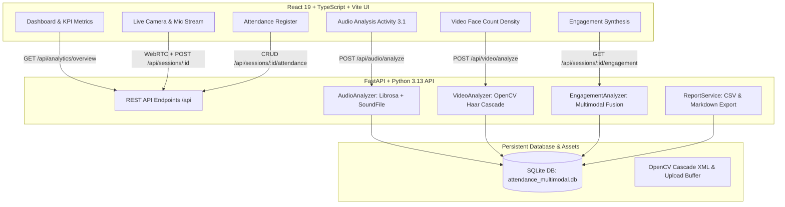

# Multimodal Attendance & Engagement Agent

[](https://www.python.org/)
[](https://fastapi.tiangolo.com/)
[](https://react.dev/)
[](https://opencv.org/)
[](https://librosa.org/)
[](LICENSE)

An end-to-end multimodal Artificial Intelligence system designed for smart classroom telemetry, attendance management, and explainable student engagement synthesis. Built for college project evaluation, academic technical interviews, and practical laboratory demonstrations.

---

## 1. Project Overview

Modern educational environments require holistic, non-intrusive tools to audit classroom dynamics without compromising student privacy. The **Multimodal Attendance & Engagement Agent** combines:

1. **Acoustic Signal Processing (Activity 3.1)**: Time-frequency audio feature extraction, 16 kHz sample rate normalization, segment Root Mean Square (RMS) energy, downsampled waveform visualization, and zero-crossing speech-activity heuristics.
2. **Computer Vision Presence Analytics**: Temporal frame sampling, OpenCV Haar Cascade and YuNet deep face detection, visible attendee counting over time, and annotated snapshot previews.
3. **Auditable Attendance Register**: Consent-authorized student roster check-ins, manual override controls, duplicate prevention, and standard RFC 4180 CSV export.
4. **Explainable Multimodal Engagement Synthesis**: A transparent, weighted heuristic formula fusing synchronized acoustic and visual signals into a 0–100 participation vitality score.
5. **Interactive Full-Stack Web Application**: A responsive React + TypeScript dashboard with WebRTC camera streaming and Web Audio API loudness monitoring.

---

## 2. Key Features

- **Activity 3.1 Audio Signal Processing Pipeline**:
  - Automatically converts stereo audio to mono.
  - Normalizes sample rate to 16,000 Hz.
  - Configurable 2.0-second segmentation windows.
  - Segment-by-segment RMS energy and zero-crossing speech detection.
  - Generates downsampled numerical waveform points for rapid SVG/Canvas rendering.
  - In-browser 1-click synthetic waveform generator for instant offline testing.
- **Computer Vision Presence Detection**:
  - Samples video frames at 1.0-second intervals to minimize CPU overhead.
  - Detects visible human faces with OpenCV Haar Cascade.
  - Generates annotated thumbnails with bounding box overlays and timestamps.
  - Computes average, maximum, and minimum visible attendee counts.
- **Privacy & Ethical Governance**:
  - **No automated biometric naming**: Face counts are anonymous presence metrics; faces are never secretly matched to student names without explicit consent.
  - **Explainable indicator**: Does not claim to measure psychological emotion, attention, or understanding.
  - **Local-first execution**: All audio and video processing is conducted strictly on the local machine with ephemeral file deletion.
- **Session Management & Reports**:
  - Complete session lifecycle (Scheduled → Live → Completed).
  - WebRTC live camera preview + Web Audio API loudness meter.
  - Downloadable Markdown audit summaries and time-aligned CSV exports.
  - One-click sample demo data initialization for immediate viva and interview demonstrations.

---

## 3. System Architecture



---

## 4. Tech Stack

| Domain | Technology | Purpose |
| :--- | :--- | :--- |
| **Frontend UI** | React 19, TypeScript, Vite | Modern, typed single-page application |
| **Styling** | Tailwind CSS v4 | Curated sleek design, responsive layout, dark/light cards |
| **Data Viz** | Recharts, Lucide React | AreaCharts, LineCharts, ComposedCharts, modern icons |
| **Backend API** | Python 3.13 / FastAPI, Uvicorn | High-performance asynchronous REST API |
| **Database** | SQLite, SQLAlchemy 2.0 | Embedded relational storage for sessions and analytics |
| **Acoustic ML** | Librosa, SoundFile, NumPy, SciPy | 16 kHz resample, RMS calculation, speech heuristics |
| **Vision ML** | OpenCV (cv2) 4.14 | Frame extraction, Haar Cascade face detection, JPEG encoding |
| **Testing** | Pytest, FastAPI TestClient | Comprehensive automated backend unit and integration tests |

---

## 5. Folder Structure

```
attendance-multimodel/
├── backend/
│   ├── app/
│   │   ├── assets/
│   │   │   └── haarcascade_frontalface_default.xml # Bundled OpenCV face cascade
│   │   ├── models/
│   │   │   ├── student.py                          # Student SQLAlchemy model
│   │   │   ├── session.py                          # Classroom Session model
│   │   │   ├── attendance.py                       # Attendance with unique constraints
│   │   │   └── analysis.py                         # Audio, Video & Engagement models
│   │   ├── schemas/
│   │   │   ├── student.py, session.py, attendance.py
│   │   │   ├── analysis.py                         # Activity 3.1 response schema
│   │   │   └── analytics.py                        # KPI overview schemas
│   │   ├── routes/
│   │   │   ├── health.py                           # GET /api/health
│   │   │   ├── students.py                         # Student CRUD
│   │   │   ├── sessions.py                         # Session start/stop/create
│   │   │   ├── attendance.py                       # Attendance & CSV export
│   │   │   ├── audio.py                            # POST /api/audio/analyze
│   │   │   ├── video.py                            # POST /api/video/analyze
│   │   │   ├── analytics.py                        # Overview & reports
│   │   │   └── demo.py                             # POST /api/demo/seed
│   │   ├── services/
│   │   │   ├── audio_analysis.py                   # Activity 3.1 AudioAnalyzer
│   │   │   ├── video_analysis.py                   # OpenCV VideoAnalyzer
│   │   │   ├── engagement_analysis.py              # Multimodal fusion algorithm
│   │   │   └── report_service.py                   # Markdown/CSV generator
│   │   ├── utils/
│   │   │   ├── file_validation.py                  # Extension, size & traversal guards
│   │   │   └── timestamps.py                       # UTC and formatting helpers
│   │   ├── config.py                               # Pydantic Settings configuration
│   │   ├── database.py                             # SQLAlchemy session & engine
│   │   └── main.py                                 # FastAPI application entrypoint
│   ├── tests/
│   │   └── test_backend.py                         # 11 comprehensive Pytest suites
│   ├── requirements.txt                            # Python dependencies
│   └── .env.example
├── frontend/
│   ├── src/
│   │   ├── components/
│   │   │   ├── Sidebar.tsx                         # Blue navigation sidebar
│   │   │   └── Navbar.tsx                          # Header and quick session modal
│   │   ├── pages/
│   │   │   ├── Dashboard.tsx                       # KPI cards & trends
│   │   │   ├── LiveSession.tsx                     # WebRTC camera & mic stream
│   │   │   ├── Attendance.tsx                      # Student roster & CSV export
│   │   │   ├── AudioAnalysis.tsx                   # Activity 3.1 Audio processor
│   │   │   ├── VideoAnalysis.tsx                   # OpenCV Face density & thumbnails
│   │   │   ├── EngagementAnalytics.tsx             # Multimodal synchronized timeline
│   │   │   ├── SessionHistory.tsx                  # Archived reports & logs
│   │   │   └── Settings.tsx                        # Privacy, hardware & health
│   │   ├── services/
│   │   │   └── api.ts                              # Central typed API client
│   │   ├── types/
│   │   │   └── index.ts                            # TypeScript domain definitions
│   │   ├── App.tsx                                 # Router configuration
│   │   ├── index.css                               # Tailwind CSS v4 styles
│   │   └── main.tsx
│   ├── package.json
│   ├── vite.config.ts
│   └── .env.example
├── run_backend.bat                                 # Quick start for Backend
├── run_frontend.bat                                # Quick start for Frontend
├── start_all.bat                                   # One-click launch for entire system
├── .gitignore
└── README.md
```

---

## 6. Prerequisites

- **Python**: Version 3.10, 3.11, 3.12, or 3.13.
- **Node.js**: Version 18, 20, 22, or 24.
- **Web Browser**: Chrome, Edge, Firefox, or Safari supporting HTML5 `getUserMedia`.
- **Operating System**: Windows, macOS, or Linux.

---

## 7. Python Environment Setup

Open PowerShell or Terminal in the project root directory:

```powershell
# 1. Create a virtual environment
python -m venv venv

# 2. Activate the virtual environment
# On Windows:
.\venv\Scripts\Activate.ps1
# On macOS/Linux:
# source venv/bin/activate
```

---

## 8. Backend Installation

With the virtual environment activated:

```powershell
# Install all required Python packages
pip install -r backend/requirements.txt
```

---

## 9. Frontend Installation

Navigate to the `frontend` directory:

```powershell
cd frontend
npm install
cd ..
```

---

## 10. Environment Variable Configuration

Copies of `.env.example` are preconfigured with local development defaults:

- Backend (`backend/.env`):
  ```env
  PROJECT_NAME="Multimodal Attendance & Engagement Agent"
  VERSION="1.0.0"
  DATABASE_URL="sqlite:///./attendance_multimodal.db"
  MAX_UPLOAD_SIZE_BYTES=104857600
  AUDIO_TARGET_SAMPLE_RATE=16000
  AUDIO_SEGMENT_DURATION_SEC=2.0
  ENABLE_PERSISTENT_RECORDING_STORAGE=false
  ```
- Frontend (`frontend/.env`):
  ```env
  VITE_API_BASE_URL="http://127.0.0.1:8000"
  ```

---

## 11. Database Initialization

The SQLite database file (`attendance_multimodal.db`) and all required tables are automatically created on backend startup via SQLAlchemy metadata reflection.

---

## 12. How to Start the Backend

From the project root:

```powershell
# Direct command with venv:
.\venv\Scripts\python.exe -m uvicorn app.main:app --host 127.0.0.1 --port 8000 --reload --app-dir backend
```

Or simply double-click `run_backend.bat`.

The FastAPI server will be available at:
- **API URL**: `http://127.0.0.1:8000`
- **Swagger Documentation**: `http://127.0.0.1:8000/docs`

---

## 13. How to Start the Frontend

In a separate terminal:

```powershell
cd frontend
npm run dev
```

Or simply double-click `run_frontend.bat`.

The web application will open at:
- **Frontend URL**: `http://localhost:5173`

> **Tip**: You can also double-click `start_all.bat` to launch both servers simultaneously!

---

## 14. API Endpoint Documentation

| Method | Endpoint | Description |
| :--- | :--- | :--- |
| `GET` | `/api/health` | Diagnostic status of service, DB, and pipelines |
| `GET` | `/api/analytics/overview` | Aggregated KPI stats, attendance and engagement trends |
| `GET` | `/api/students` | List enrolled students (supports search and department filters) |
| `POST` | `/api/students` | Enroll a new student |
| `GET` | `/api/sessions` | List classroom sessions |
| `POST` | `/api/sessions` | Create a classroom session |
| `POST` | `/api/sessions/{id}/start` | Mark session as LIVE and begin timing |
| `POST` | `/api/sessions/{id}/stop` | Terminate session and compute duration |
| `GET` | `/api/sessions/{id}/attendance` | Fetch attendance records with student metadata |
| `POST` | `/api/sessions/{id}/attendance` | Mark/update attendance record |
| `POST` | `/api/sessions/{id}/attendance/bulk`| Bulk mark attendance records |
| `GET` | `/api/sessions/{id}/attendance/export` | Download RFC 4180 CSV attendance register |
| `POST` | `/api/audio/analyze` | Activity 3.1: Upload audio file & extract RMS energy/speech |
| `POST` | `/api/video/analyze` | Upload video file & extract face counts and previews |
| `GET` | `/api/sessions/{id}/engagement` | Calculate explainable multimodal engagement score |
| `GET` | `/api/sessions/{id}/report` | Generate comprehensive session audit report (JSON/MD) |
| `POST` | `/api/demo/seed` | Seed instant sample demonstration data |

---

## 15. How to Upload and Analyze Audio (Activity 3.1)

1. Open the **Audio Analysis** page in the left sidebar.
2. Click **Select Audio File** and upload a `.wav`, `.mp3`, or `.flac` recording, **OR** click **Generate 1-Click Synthetic Audio** to create a live 4-second WAV file directly in the browser.
3. Click **Run Audio Extraction**.
4. Review the outputs:
   - Normalized 16 kHz sample rate and channel conversions.
   - Downsampled peak envelope waveform visualization.
   - Segment-level Root Mean Square (RMS) energy chart.
   - Estimated speech activity intervals.
   - Numerical segment breakdown table.

---

## 16. How to Upload and Analyze Video

1. Open the **Video Analysis** page in the left sidebar.
2. Select a video recording (`.mp4`, `.mov`, `.avi`, `.webm`).
3. Click **Process Video Frames**.
4. The backend samples frames at 1-second intervals and runs the OpenCV face detector.
5. Review the resulting visible face count timeline, average/peak face density, and annotated JPEG thumbnails with bounding boxes.

---

## 17. How to Conduct a Classroom Session

1. Click **New Classroom Session** in the top navigation bar.
2. Enter the title (e.g., "Computer Vision Lab 4"), Course, and Instructor.
3. Click **Launch Session** to open the **Live Session** view.
4. Click **Enable Camera & Mic** to activate local WebRTC video and the Web Audio loudness meter.
5. Click **Start Live Broadcast** to begin session timing.
6. Open **Attendance** to record present, late, or absent students, or click **Mark All Present**.
7. Once finished, click **End Session**.
8. Navigate to **Engagement** or **Session History** to inspect the multimodal participation report and export the attendance CSV.

---

## 18. How to Run Tests

Run the complete 11-test Pytest suite:

```powershell
.\venv\Scripts\pytest.exe backend/tests/test_backend.py -v
```

All 11 tests will execute against an isolated temporary SQLite database:
```
backend/tests/test_backend.py::test_health_check PASSED
backend/tests/test_backend.py::test_student_flow PASSED
backend/tests/test_backend.py::test_session_lifecycle PASSED
backend/tests/test_backend.py::test_attendance_recording PASSED
backend/tests/test_backend.py::test_audio_analysis_sine_wave PASSED
backend/tests/test_backend.py::test_silent_audio PASSED
backend/tests/test_backend.py::test_invalid_audio_file PASSED
backend/tests/test_backend.py::test_invalid_video_file PASSED
backend/tests/test_backend.py::test_engagement_calculation PASSED
backend/tests/test_backend.py::test_analytics_overview PASSED
backend/tests/test_backend.py::test_demo_seeding_and_report PASSED
======================== 11 passed in 3.4s ========================
```

---

## 19. Common Errors and Solutions

| Symptom | Cause | Solution |
| :--- | :--- | :--- |
| `Camera/Mic access denied` | Browser permissions blocked or HTTP context | Click the lock/tune icon in the browser address bar and set Camera/Microphone to "Allow". Alternatively, upload prerecorded media files. |
| `TypeError: can't subtract offset-naive and offset-aware datetimes` | SQLite datetime tzinfo mismatch | Handled automatically in `backend/app/routes/sessions.py` with tzinfo normalization. |
| `Failed to decode audio` | Unsupported or corrupted audio codec | Ensure file is standard WAV, MP3, or OGG. Use the built-in synthetic generator to test. |
| `CORS Error in browser` | Frontend port not whitelisted | The backend CORS middleware is configured for wildcard origins `["*"]` for local development. |

---

## 20. Hardware Requirements

- **Minimum**: Any standard dual-core laptop or desktop with 4 GB RAM.
- **Recommended**: Intel Core i5 / AMD Ryzen 5 or higher, 8 GB RAM, built-in webcam and microphone.
- **GPU**: Not strictly required; OpenCV Haar Cascade and Librosa operate efficiently on standard multi-core CPUs.

---

## 21. Privacy and Consent Considerations

1. **Authorization**: Classroom recordings must only be conducted with prior student and institutional awareness.
2. **Ephemeral Media Storage**: By default (`ENABLE_PERSISTENT_RECORDING_STORAGE=false`), raw video and audio files are discarded immediately after feature extraction. Only aggregated numerical telemetry and timestamps are stored.
3. **Identity Decoupling**: Face detection enumerates detected human faces within the field of view; it never maps faces to named student records without a separate, consented identity verification workflow.

---

## 22. Current Limitations and Future Roadmap

- **Occlusion & Head Pose**: Students seated in camera blind spots or looking down at notebooks may not trigger frontal face detectors. Future versions could integrate multi-camera bird's-eye views.
- **Acoustic Overlap**: Background HVAC hum or projector noise can affect RMS baselines. Future work can incorporate spectral subtraction or Wiener filtering.
- **Identity Verification**: Future extension will allow students to opt-in to secure, zero-knowledge biometric check-in tokens.
